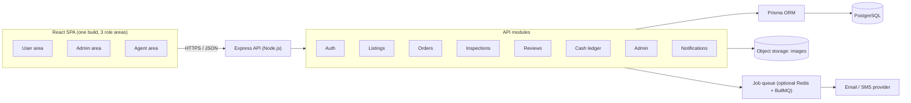
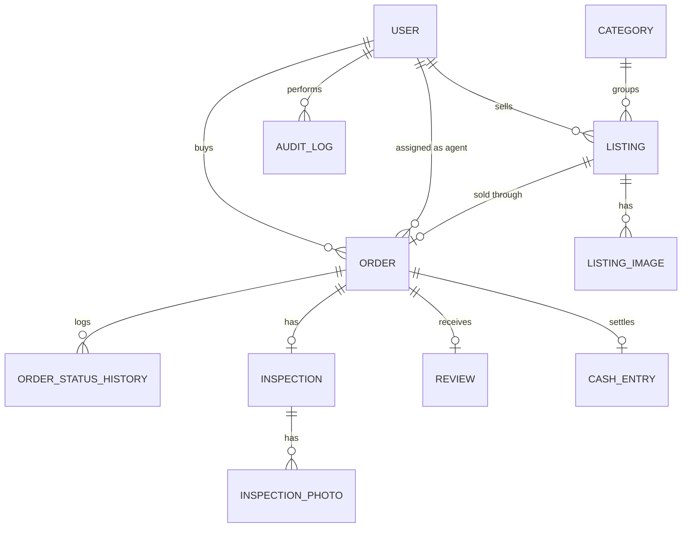
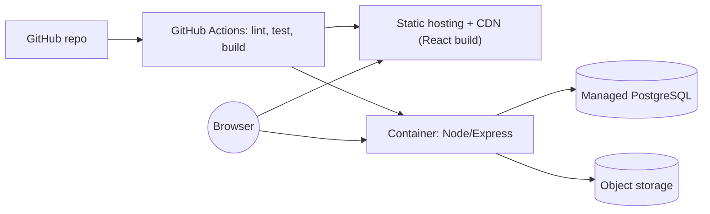
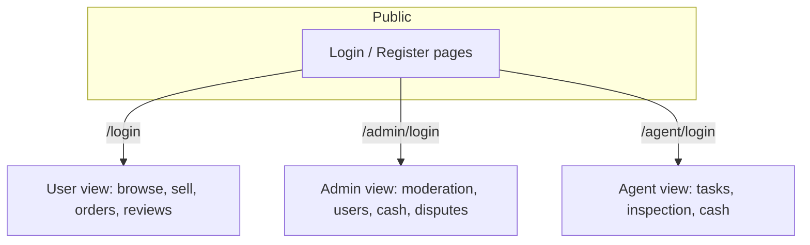
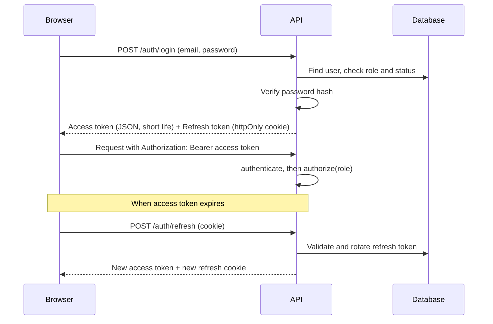
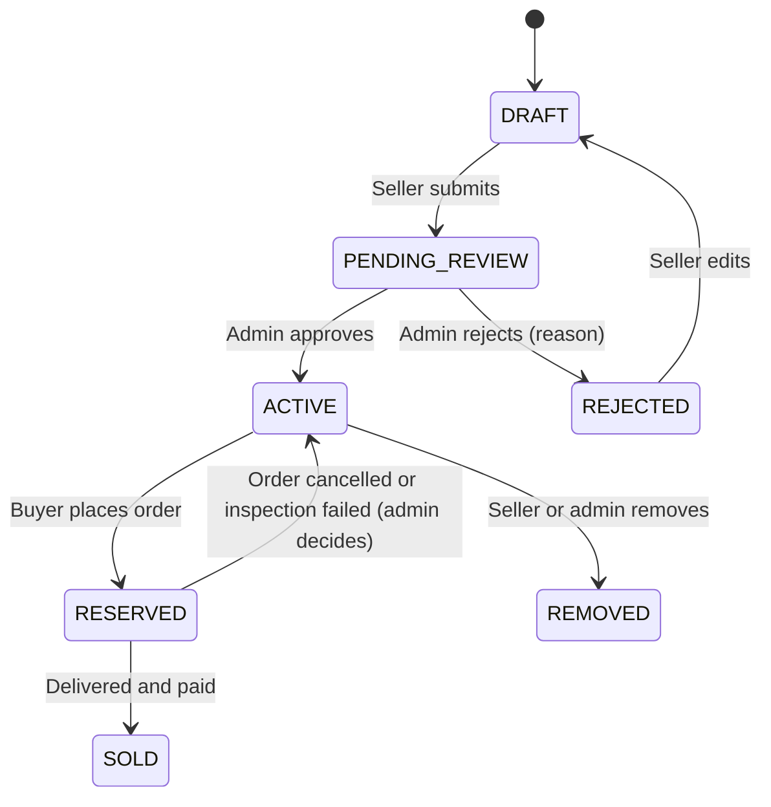
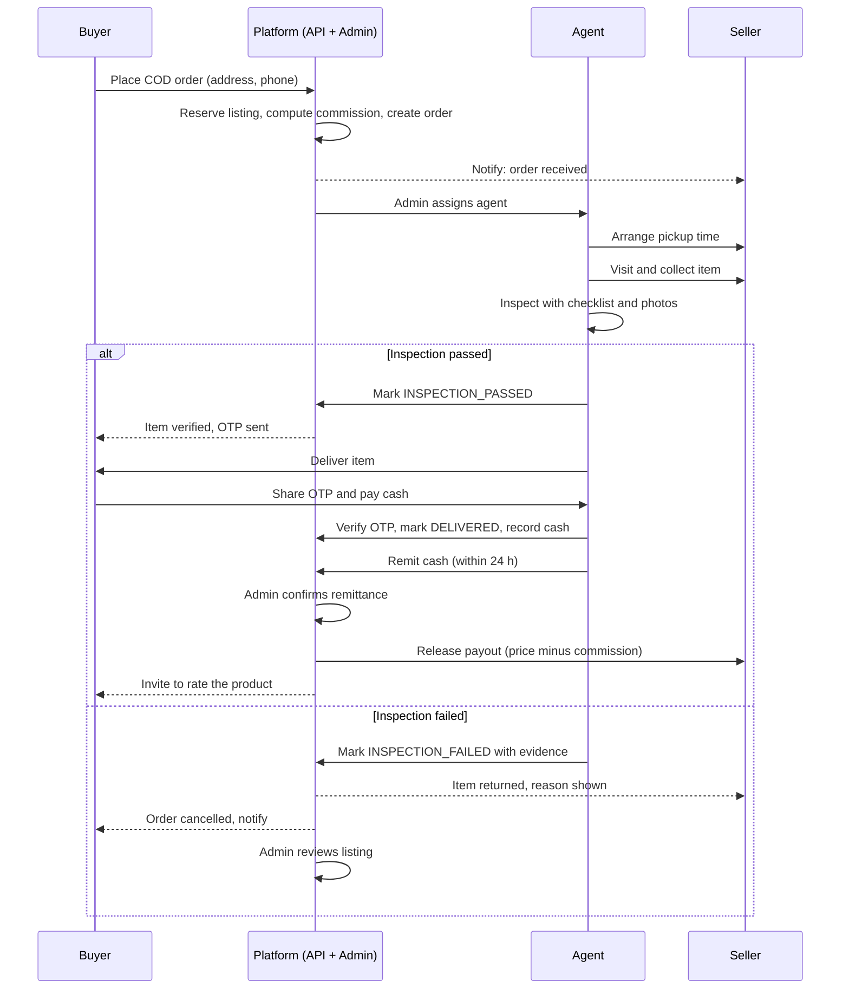
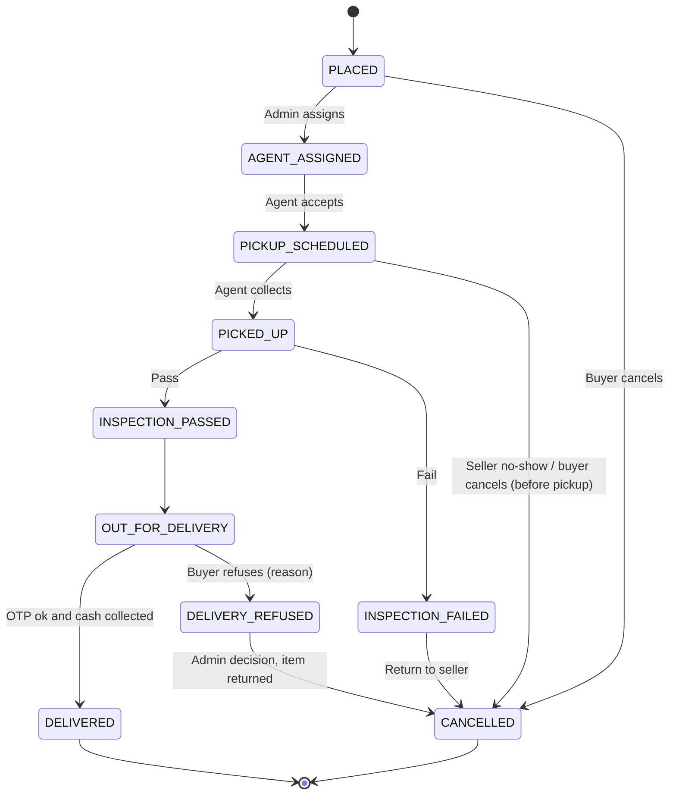

# PartXchange: Project Documentation

> **PartXchange** is a working name. Rename it anywhere.
> A marketplace for used laptop and PC components (GPUs, CPUs, RAM, monitors, controllers, joysticks) that are affordable and verified for quality.

**Documents in this file**

1. [Product Requirements Document (PRD)](#1-product-requirements-document-prd)
2. [Technical Architecture](#2-technical-architecture)
3. [System Workflow](#3-system-workflow)
4. [Security Architecture](#4-security-architecture)
5. [Technology Stack](#5-technology-stack)

**Decisions already made (from your answers)**

| Topic | Decision |
|---|---|
| Payment | Cash on Delivery (COD) / pay at handover. No online payment gateway in v1 |
| Pickup & shipper | Picks up from the seller, **inspects** the item, then delivers to the buyer |
| Roles | User (buyer + seller in one account), Admin, Pickup & Shipper (Agent) |
| Stack | React, Node.js, Express.js, PostgreSQL, Prisma ORM |

---

# 1. Product Requirements Document (PRD)

## 1.1 Problem

Good used PC parts are hard to buy safely. Buyers worry about fake or damaged parts and scams. Sellers worry about time-wasting buyers and meetups with strangers. Marketplace listings carry no quality guarantee.

## 1.2 Vision

A trusted peer-to-peer marketplace where **every item is physically inspected by a platform agent before it reaches the buyer**. Used hardware becomes affordable, and quality is guaranteed by inspection and by a verified-purchase review system.

## 1.3 Goals and non-goals

**Goals (v1)**
- Let users list and buy used components with simple, honest listings.
- Guarantee a quality check through the agent inspection step.
- Handle cash safely through a traceable COD and settlement ledger.
- Give admins full control over users, listings, disputes and payouts.
- Give agents a simple mobile-friendly task flow.
- Provide a smooth, fast, polished interface.

**Non-goals (v1)**
- Online payment gateway or escrow wallet (planned for v2).
- Native mobile apps (the web app will be responsive).
- Auctions or bidding.
- In-app real-time chat between buyer and seller (v2; v1 uses structured "ask a question" on the listing).

## 1.4 User roles (personas)

| Role | Who | Main needs |
|---|---|---|
| **User** | Anyone who buys or sells | Find good parts at fair prices, list items fast, trust the quality |
| **Admin** | Platform staff | Moderate listings, manage agents, resolve disputes, reconcile cash |
| **Agent (Pickup & Shipper)** | Field staff or partner | Clear pickup and delivery tasks, an inspection checklist, easy cash tracking |

Each role has its **own login page and its own dashboard**.

## 1.5 Core user journeys

**Seller:** Sign up → create listing (photos, specs, condition, price) → admin approves → buyer orders → agent picks up and inspects → item sold → seller gets payout after the platform receives the cash.

**Buyer:** Browse and filter → view listing and seller rating → place COD order → track status → receive the item with a delivery OTP → pay the agent → rate the product.

**Agent:** Log in → see assigned tasks → navigate to seller → run the inspection checklist and upload photos → pass or fail → deliver to buyer → verify OTP → collect cash → submit cash to the platform.

**Admin:** Review new listings → manage users and agents → assign or reassign agents → handle failed inspections and disputes → confirm cash remittance and release seller payouts.

## 1.6 Functional requirements

### A. Authentication and accounts
| ID | Requirement | Priority |
|---|---|---|
| AUTH-1 | Separate login pages: `/login` (user), `/admin/login`, `/agent/login` | Must |
| AUTH-2 | User self-registration with email + password and email verification | Must |
| AUTH-3 | Admins are seeded or created by a super admin. Agents are created by invitation from an admin (no public signup) | Must |
| AUTH-4 | Forgot and reset password via a time-limited email link | Must |
| AUTH-5 | Phone number verification by OTP before first listing or order (needed for COD trust) | Should |
| AUTH-6 | Session management: view and log out of devices | Could |

### B. Listings
| ID | Requirement | Priority |
|---|---|---|
| LST-1 | Create, edit and delete a listing: title, category, brand, model, specs, condition, age, price, pickup area, 2 to 8 photos | Must |
| LST-2 | Category-specific spec fields (for example a GPU has VRAM and interface; RAM has capacity, type and speed) | Must |
| LST-3 | Condition grades: Like New, Good, Fair, For Parts | Must |
| LST-4 | Admin approval before a listing goes live (reduces fake and spam listings) | Must |
| LST-5 | Listing status: Draft, Pending Review, Active, Reserved, Sold, Rejected, Removed | Must |
| LST-6 | Show a "Platform Inspected" badge after a successful inspection (for relisted or repeat items) | Could |

### C. Discovery
| ID | Requirement | Priority |
|---|---|---|
| DSC-1 | Search by keyword, filter by category, brand, price, condition, area; sort by price, newest, rating | Must |
| DSC-2 | Listing detail page with image gallery, specs table, seller profile and rating, reviews | Must |
| DSC-3 | Wishlist (save for later) | Should |
| DSC-4 | "Similar items" suggestions | Could |

### D. Orders and COD
| ID | Requirement | Priority |
|---|---|---|
| ORD-1 | Buyer places an order with a delivery address and phone number. The listing becomes **Reserved** | Must |
| ORD-2 | Order status timeline visible to buyer and seller | Must |
| ORD-3 | Buyer can cancel before pickup. After pickup, only admin can cancel | Must |
| ORD-4 | Delivery OTP is sent to the buyer and must be given to the agent at handover | Must |
| ORD-5 | Platform commission (percentage) is calculated per order and shown to the seller before listing | Must |
| ORD-6 | Delivery fee shown clearly to the buyer at checkout | Must |

### E. Agent inspection
| ID | Requirement | Priority |
|---|---|---|
| INS-1 | Inspection checklist per category (physical damage, powers on, stress test notes, matches the listing, accessories) | Must |
| INS-2 | Agent uploads 2 to 6 inspection photos and gives a Pass or Fail result with notes | Must |
| INS-3 | On **Fail**, the order is cancelled, the seller is notified, and the listing returns to Active or is flagged | Must |
| INS-4 | On **Pass**, the agent takes custody and proceeds to delivery | Must |
| INS-5 | Buyer can refuse delivery if the item does not match the inspection record (reason is required). Admin reviews the case | Must |

### F. Reviews and ratings
| ID | Requirement | Priority |
|---|---|---|
| REV-1 | Only buyers with a **Delivered** order can review (verified purchase) | Must |
| REV-2 | 1 to 5 star rating plus optional text and photos. One review per order | Must |
| REV-3 | Separate ratings: **Product** and **Seller** (and an optional agent rating) | Should |
| REV-4 | Average rating and review count shown on listings and seller profiles | Must |
| REV-5 | Users can report an abusive review. Admin can hide it | Must |
| REV-6 | Seller can post one public reply to a review | Could |

### G. Admin
| ID | Requirement | Priority |
|---|---|---|
| ADM-1 | Dashboard: orders today, pending listings, cash in hand with agents, disputes | Must |
| ADM-2 | Approve or reject listings with a reason | Must |
| ADM-3 | Manage users (suspend, unsuspend) and agents (invite, deactivate) | Must |
| ADM-4 | Assign or reassign an agent to an order (manual in v1; auto-assignment by area in v2) | Must |
| ADM-5 | Cash ledger: record agent cash remittance, release seller payouts | Must |
| ADM-6 | Dispute management and refund or cancel decisions | Must |
| ADM-7 | Category and spec-template management | Should |
| ADM-8 | Audit log viewer | Should |

### H. Agent app
| ID | Requirement | Priority |
|---|---|---|
| AGT-1 | Task list (today's pickups and deliveries) with address, phone, map link | Must |
| AGT-2 | Mobile-first UI with large buttons, usable one-handed | Must |
| AGT-3 | Cash-in-hand counter and a remittance history | Must |
| AGT-4 | Task status updates: Accepted, Picked Up, Inspected, Out for Delivery, Delivered | Must |

## 1.7 Non-functional requirements

| Area | Requirement |
|---|---|
| Performance | Listing page loads in under 2 s on a normal 4G connection; API p95 under 300 ms for reads |
| Availability | 99.5% target for v1 |
| Scalability | Stateless API, so it can scale horizontally; DB indexes on search fields |
| Security | See Document 4 |
| Accessibility | WCAG 2.1 AA basics: keyboard navigation, contrast, alt text, labels |
| Compatibility | Latest 2 versions of Chrome, Edge, Safari, Firefox; mobile 360 px and up |
| Observability | Structured logs, error tracking, health endpoints |

## 1.8 UX principles ("smooth and good interaction")

1. **Instant feedback:** skeleton loaders instead of spinners; optimistic updates for wishlist, save and reply actions.
2. **Smooth motion:** subtle page transitions, hover and press states, animated order timeline (Framer Motion). Respect `prefers-reduced-motion`.
3. **Forgiving forms:** inline validation, auto-save listing drafts, clear error messages, image drag-and-drop with previews and progress.
4. **Fast browsing:** debounced search, URL-synced filters (shareable links), infinite scroll or "load more" with preserved scroll position.
5. **Trust cues:** condition badges, inspection badge, verified-purchase tag, seller rating next to every price.
6. **Role-appropriate UI:** user pages are visual and browsing-focused, the admin area is table-and-filter focused, and the agent area is task-card focused.
7. **Toasts and confirmations:** non-blocking toasts for success, and confirm dialogs only for risky actions (cancel, delete).
8. **Dark and light theme**, responsive layout, and keyboard shortcuts for admin power users (v2).

## 1.9 Success metrics

| Metric | Target (first 3 months) |
|---|---|
| Listing approval time | under 24 h |
| Inspection pass rate | tracked (flag if below 70%) |
| Order completion rate | above 75% |
| Average product rating | above 4.0 |
| Cash remittance delay (agent to platform) | under 24 h |
| Repeat buyers | above 20% |

## 1.10 Risks and mitigations

| Risk | Mitigation |
|---|---|
| Agent cash theft or loss | Daily remittance rule, cash-in-hand limits per agent, ledger plus admin confirmation, audit log |
| Fake or no-show buyers (COD) | Phone OTP, delivery OTP, refusal reasons tracked, repeat refusers get restricted |
| Fraudulent sellers | Admin approval, inspection, seller rating, suspension |
| Inspection disputes | Photo evidence stored with timestamps, checklist record |
| Counterfeit parts | Category-specific checklists, serial number capture for GPUs and CPUs, admin spot checks |

## 1.11 Release plan

| Phase | Scope |
|---|---|
| **MVP (v1)** | Auth for 3 roles, listings with approval, search, COD order flow, agent inspection and delivery, reviews, admin panel, cash ledger |
| **v1.1** | Wishlist, phone OTP, notifications (email), seller reply to reviews |
| **v2** | Online payments and escrow, in-app chat, auto agent assignment, native-like PWA, price suggestions |

## 1.12 Open questions (answer when you are ready)

- Which city or region will you launch in first? (This affects agent coverage and delivery fees.)
- What commission percentage and delivery fee model do you want?
- Will the agent carry parts directly to the buyer, or will there be a warehouse or hub in v2?

---

# 2. Technical Architecture

## 2.1 Architecture style

A **modular monolith** for v1: one Express API with clear domain modules, one PostgreSQL database, one React single-page app. This is simpler to build and deploy than microservices and still easy to split later.

## 2.2 High-level diagram



## 2.3 Frontend architecture

**Structure (feature-based)**

```
client/
  src/
    app/                # router, providers, layouts
    features/
      auth/             # login pages for user / admin / agent
      listings/         # browse, detail, create/edit
      orders/           # checkout, tracking
      reviews/
      admin/            # dashboards, moderation, ledger
      agent/            # tasks, inspection form, cash
    components/         # shared UI (Button, Modal, Rating, Skeleton...)
    lib/                # api client, auth helpers, utils
    hooks/
    styles/
```

**Key decisions**
- **React Router** with three route trees: `/` (user), `/admin/*`, `/agent/*`. Each tree is wrapped in a `RoleGuard`.
- **TanStack Query** for server state (caching, retries, optimistic updates). Lightweight **Zustand** only for UI state (theme, filters drawer).
- Code splitting per role area so users never download admin code.
- One shared API client that attaches the access token and handles silent refresh.

## 2.4 Backend architecture

**Layered modules**

```
server/
  src/
    modules/
      auth/        routes → controller → service → repository(Prisma)
      users/
      listings/
      orders/
      inspections/
      reviews/
      cash/
      admin/
      notifications/
    middleware/    # authenticate, authorize(role), validate(zod), rateLimit, errorHandler
    config/
    lib/           # logger, mailer, storage, otp
    prisma/        # schema.prisma, migrations, seed.ts
    app.ts
    server.ts
```

- **Routes** define endpoints and attach middleware.
- **Controllers** are thin (parse request, call service, shape response).
- **Services** hold business rules (state transitions, commission calculation).
- **Repositories** (Prisma calls) keep DB code in one place.
- Use **database transactions** for any multi-table change (for example placing an order and reserving a listing).

## 2.5 Database design

### Entities (ER view)



### Prisma schema (starting point)

```prisma
generator client {
  provider = "prisma-client-js"
}

datasource db {
  provider = "postgresql"
  url      = env("DATABASE_URL")
}

enum Role {
  USER
  ADMIN
  AGENT
}

enum AccountStatus {
  ACTIVE
  SUSPENDED
  INVITED
}

enum Condition {
  LIKE_NEW
  GOOD
  FAIR
  FOR_PARTS
}

enum ListingStatus {
  DRAFT
  PENDING_REVIEW
  ACTIVE
  RESERVED
  SOLD
  REJECTED
  REMOVED
}

enum OrderStatus {
  PLACED
  AGENT_ASSIGNED
  PICKUP_SCHEDULED
  PICKED_UP
  INSPECTION_PASSED
  INSPECTION_FAILED
  OUT_FOR_DELIVERY
  DELIVERED
  DELIVERY_REFUSED
  CANCELLED
}

enum CashStatus {
  WITH_AGENT
  REMITTED
  PAYOUT_RELEASED
}

model User {
  id            String        @id @default(cuid())
  email         String        @unique
  passwordHash  String
  name          String
  phone         String?       @unique
  phoneVerified Boolean       @default(false)
  emailVerified Boolean       @default(false)
  role          Role          @default(USER)
  status        AccountStatus @default(ACTIVE)
  area          String?       // agent coverage or user area
  createdAt     DateTime      @default(now())
  updatedAt     DateTime      @updatedAt

  listings      Listing[]
  ordersBought  Order[]       @relation("Buyer")
  ordersAgent   Order[]       @relation("Agent")
  reviews       Review[]
  addresses     Address[]
  refreshTokens RefreshToken[]
  auditLogs     AuditLog[]
}

model Address {
  id      String @id @default(cuid())
  userId  String
  user    User   @relation(fields: [userId], references: [id])
  line1   String
  line2   String?
  city    String
  state   String
  pincode String
  phone   String
}

model Category {
  id        String    @id @default(cuid())
  name      String    @unique   // GPU, CPU, RAM, Monitor, Controller...
  specSchema Json               // defines category-specific fields
  listings  Listing[]
}

model Listing {
  id          String        @id @default(cuid())
  sellerId    String
  seller      User          @relation(fields: [sellerId], references: [id])
  categoryId  String
  category    Category      @relation(fields: [categoryId], references: [id])
  title       String
  brand       String
  model       String
  specs       Json          // validated against category.specSchema
  condition   Condition
  ageMonths   Int?
  price       Decimal       @db.Decimal(10, 2)
  area        String
  description String
  status      ListingStatus @default(DRAFT)
  rejectReason String?
  createdAt   DateTime      @default(now())
  updatedAt   DateTime      @updatedAt

  images      ListingImage[]
  order       Order?

  @@index([status, categoryId])
  @@index([price])
  @@index([area])
}

model ListingImage {
  id        String  @id @default(cuid())
  listingId String
  listing   Listing @relation(fields: [listingId], references: [id], onDelete: Cascade)
  url       String
  position  Int
}

model Order {
  id             String      @id @default(cuid())
  listingId      String      @unique
  listing        Listing     @relation(fields: [listingId], references: [id])
  buyerId        String
  buyer          User        @relation("Buyer", fields: [buyerId], references: [id])
  agentId        String?
  agent          User?       @relation("Agent", fields: [agentId], references: [id])
  status         OrderStatus @default(PLACED)
  itemPrice      Decimal     @db.Decimal(10, 2)
  deliveryFee    Decimal     @db.Decimal(10, 2)
  commission     Decimal     @db.Decimal(10, 2)
  totalToCollect Decimal     @db.Decimal(10, 2)
  deliveryAddress Json
  deliveryOtpHash String?
  cancelReason   String?
  createdAt      DateTime    @default(now())
  updatedAt      DateTime    @updatedAt

  history        OrderStatusHistory[]
  inspection     Inspection?
  review         Review?
  cash           CashEntry?

  @@index([buyerId])
  @@index([agentId, status])
}

model OrderStatusHistory {
  id        String      @id @default(cuid())
  orderId   String
  order     Order       @relation(fields: [orderId], references: [id], onDelete: Cascade)
  status    OrderStatus
  note      String?
  actorId   String?
  createdAt DateTime    @default(now())
}

model Inspection {
  id        String   @id @default(cuid())
  orderId   String   @unique
  order     Order    @relation(fields: [orderId], references: [id])
  agentId   String
  passed    Boolean
  checklist Json     // item → pass/fail
  serialNo  String?
  notes     String?
  createdAt DateTime @default(now())
  photos    InspectionPhoto[]
}

model InspectionPhoto {
  id           String     @id @default(cuid())
  inspectionId String
  inspection   Inspection @relation(fields: [inspectionId], references: [id], onDelete: Cascade)
  url          String
}

model Review {
  id          String   @id @default(cuid())
  orderId     String   @unique
  order       Order    @relation(fields: [orderId], references: [id])
  reviewerId  String
  reviewer    User     @relation(fields: [reviewerId], references: [id])
  productRating Int    // 1..5
  sellerRating  Int    // 1..5
  comment     String?
  hidden      Boolean  @default(false)
  createdAt   DateTime @default(now())
}

model CashEntry {
  id          String     @id @default(cuid())
  orderId     String     @unique
  order       Order      @relation(fields: [orderId], references: [id])
  agentId     String
  amount      Decimal    @db.Decimal(10, 2)
  sellerPayout Decimal   @db.Decimal(10, 2)
  status      CashStatus @default(WITH_AGENT)
  remittedAt  DateTime?
  payoutAt    DateTime?
}

model RefreshToken {
  id        String   @id @default(cuid())
  userId    String
  user      User     @relation(fields: [userId], references: [id], onDelete: Cascade)
  tokenHash String   @unique
  expiresAt DateTime
  revokedAt DateTime?
  userAgent String?
  createdAt DateTime @default(now())
}

model AuditLog {
  id        String   @id @default(cuid())
  actorId   String?
  actor     User?    @relation(fields: [actorId], references: [id])
  action    String
  entity    String
  entityId  String
  meta      Json?
  createdAt DateTime @default(now())

  @@index([entity, entityId])
}
```

> A one-order-per-listing design (`listingId @unique`) fits used items because each is a single physical unit. If an order is cancelled, release the listing by clearing the order link or by using a cancelled-orders history table. Decide this during implementation.

## 2.6 API design (REST, JSON, versioned `/api/v1`)

**Auth**

| Method | Endpoint | Role | Purpose |
|---|---|---|---|
| POST | `/auth/register` | public | User signup |
| POST | `/auth/login` | public | User login |
| POST | `/auth/admin/login` | public | Admin login |
| POST | `/auth/agent/login` | public | Agent login |
| POST | `/auth/refresh` | cookie | New access token |
| POST | `/auth/logout` | any | Revoke refresh token |
| POST | `/auth/forgot-password`, `/auth/reset-password` | public | Password recovery |
| POST | `/auth/agent/accept-invite` | invite | Agent sets password |

**Listings**

| Method | Endpoint | Role | Purpose |
|---|---|---|---|
| GET | `/listings` | public | Search and filter |
| GET | `/listings/:id` | public | Detail |
| POST | `/listings` | user | Create |
| PATCH | `/listings/:id` | owner | Edit |
| DELETE | `/listings/:id` | owner/admin | Remove |
| POST | `/uploads/sign` | user/agent | Get a signed upload URL |

**Orders**

| Method | Endpoint | Role | Purpose |
|---|---|---|---|
| POST | `/orders` | user | Place COD order |
| GET | `/orders/mine` | user | Buyer/seller orders |
| POST | `/orders/:id/cancel` | user/admin | Cancel |
| GET | `/agent/tasks` | agent | Assigned tasks |
| POST | `/agent/orders/:id/pickup` | agent | Mark picked up |
| POST | `/agent/orders/:id/inspection` | agent | Submit inspection |
| POST | `/agent/orders/:id/deliver` | agent | Verify OTP, mark delivered, record cash |
| POST | `/agent/cash/remit` | agent | Declare remittance |

**Reviews**

| Method | Endpoint | Role | Purpose |
|---|---|---|---|
| POST | `/orders/:id/review` | buyer | Create a review (delivered only) |
| GET | `/listings/:id/reviews` | public | Reviews list |
| POST | `/reviews/:id/report` | user | Report |

**Admin**

| Method | Endpoint | Purpose |
|---|---|---|
| GET | `/admin/stats` | Dashboard numbers |
| GET/PATCH | `/admin/listings` | Review queue, approve/reject |
| GET/PATCH | `/admin/users` | Manage users |
| POST | `/admin/agents/invite` | Invite agent |
| POST | `/admin/orders/:id/assign` | Assign agent |
| GET/POST | `/admin/cash` | Ledger, confirm remittance, release payout |
| PATCH | `/admin/reviews/:id/hide` | Moderate review |
| GET | `/admin/audit` | Audit log |

**Response format**

```json
{ "success": true, "data": { }, "meta": { "page": 1, "total": 120 } }
{ "success": false, "error": { "code": "VALIDATION_ERROR", "message": "…", "details": [ ] } }
```

## 2.7 File and image storage

- Images are uploaded **directly from the browser to object storage** using short-lived signed URLs (the API never proxies large files).
- Allowed types: JPEG, PNG, WebP. Max 5 MB each. Server re-checks type and size.
- Generate thumbnails and WebP versions for fast loading (storage-side function or the `sharp` library in a worker).

## 2.8 Background jobs and notifications

| Job | Trigger |
|---|---|
| Send verification, reset and OTP emails/SMS | Auth events |
| Order status notifications | Every status change |
| Reminder to remit cash | Agent holding cash over 24 h |
| Auto-release stale reservations | Order PLACED but no agent action for N hours (admin alert) |

## 2.9 Deployment architecture



- **Environments:** `development`, `staging`, `production`.
- Config via environment variables. Secrets are never committed.
- Database migrations run in the pipeline with `prisma migrate deploy`.
- Automated daily database backups, with a tested restore.

---

# 3. System Workflow

## 3.1 Roles at a glance



## 3.2 Authentication workflow



Rules:
- A user account cannot log in on `/admin/login` or `/agent/login`. Each endpoint checks the role.
- Failed logins are rate limited. After repeated failures the account is temporarily locked.

## 3.3 Listing workflow



## 3.4 Main order workflow (end to end)



## 3.5 Order status state machine



Each transition is validated in the order service (only allowed transitions, only allowed roles) and recorded in `OrderStatusHistory`.

## 3.6 Cash and settlement workflow

1. Agent collects `totalToCollect` (item price + delivery fee) at delivery. A `CashEntry` is created with status `WITH_AGENT`.
2. Agent hands the cash to the platform (or deposits it) and declares remittance in the app.
3. Admin verifies the amount and marks `REMITTED`.
4. Platform pays the seller `itemPrice − commission` and marks `PAYOUT_RELEASED`.
5. Admin dashboard shows total cash currently with agents, and flags entries older than 24 h.

## 3.7 Review workflow

1. Order reaches `DELIVERED`. The buyer is notified: "How was your item?"
2. Buyer submits product rating, seller rating and an optional comment.
3. The review is published immediately (post-moderation) and updates the cached average rating on the listing and seller.
4. Anyone can report a review. Admin can hide it, and the average is recalculated.

## 3.8 Admin dispute workflow

1. Trigger: delivery refused, buyer claims "not as inspected", or the seller claims damage.
2. Admin opens the order and sees the inspection checklist, photos, timestamps and status history.
3. Admin decides: complete the sale, cancel and return, or suspend a user. The decision and reason are written to the audit log.

## 3.9 Interaction design flow (UX moments)

| Moment | Smooth interaction |
|---|---|
| Search | Debounced typing, results animate in, filters stay in the URL |
| Listing detail | Image gallery with swipe and zoom, sticky "Order" bar on mobile |
| Create listing | Stepper form (Basics → Specs → Photos → Review), draft auto-saved |
| Place order | One-page checkout, address autofill from saved addresses, clear COD note |
| Order tracking | Animated timeline that updates live (polling every 20 s, upgrade to WebSocket later) |
| Rating | Tap-to-rate stars with hover preview, optimistic submit |
| Agent inspection | Checklist with big toggles, camera capture, offline-tolerant draft |

---

# 4. Security Architecture

## 4.1 Security principles

- **Least privilege:** every endpoint checks the role and ownership.
- **Defense in depth:** validation at the client, validation at the API, constraints at the database.
- **Secure by default:** deny unless explicitly allowed.
- **Everything important is logged and traceable** (audit log).

## 4.2 Threat model summary (STRIDE-style)

| Threat | Example | Control |
|---|---|---|
| Spoofing | Stolen credentials, fake agent | Strong hashing, rate limits, agent invite-only, short-lived tokens |
| Tampering | Changing price or order status in a request | Server-side calculation, state machine, never trust client values |
| Repudiation | Agent denies collecting cash | Audit log, status history, OTP confirmation |
| Information disclosure | Seeing another user's address | Ownership checks, field-level response shaping |
| Denial of service | Request flooding | Rate limiting, request size limits, CDN or WAF |
| Elevation of privilege | User calls admin endpoint | Role middleware on every route, tests for it |

## 4.3 Authentication

| Item | Design |
|---|---|
| Password hashing | **Argon2id** (or bcrypt with cost ≥ 12 if Argon2 is not available) |
| Password policy | Minimum 10 characters, check against common-password list |
| Access token | JWT, **15 minutes**, contains `sub`, `role`, `iat`, `exp`. Kept in memory on the client (not localStorage) |
| Refresh token | Random 256-bit value, stored **hashed** in DB, sent as `httpOnly`, `Secure`, `SameSite=Strict` cookie, **7 to 30 days**, rotated on each use. Reuse of an old token revokes the whole token family |
| Separate login endpoints | `/auth/login`, `/auth/admin/login`, `/auth/agent/login`, each verifies the matching role |
| Admin protection | Admins have a shorter session, **MFA (TOTP)** required, and optional IP allow-list |
| Account lockout | Temporary lock after 5 failed attempts, with exponential backoff |
| Email verification | Required before listing or ordering |
| Phone OTP | Hashed, 5-minute expiry, limited attempts |
| Password reset | Single-use token, 15-minute expiry, stored hashed, all sessions revoked after reset |

## 4.4 Authorization (RBAC + ownership)

| Resource | USER | AGENT | ADMIN |
|---|---|---|---|
| Browse listings | Yes | Yes | Yes |
| Create / edit own listing | Yes | No | Yes |
| Approve listing | No | No | Yes |
| Place order | Yes | No | No |
| View own orders | Yes | Assigned only | All |
| Update order status | Cancel only (before pickup) | Pickup, inspection and delivery steps for **assigned** orders | All |
| Submit inspection | No | Assigned only | Override |
| Submit review | Own delivered order | No | Hide / moderate |
| Cash ledger | No | Own entries | All |
| Manage users / agents | No | No | Yes |

Implementation: `authenticate` middleware, then `authorize('ADMIN')`-style middleware, then a service-level ownership check. **Every** query for user data is scoped by the user id to prevent IDOR.

## 4.5 Application security controls

| Area | Control |
|---|---|
| Input validation | **Zod** schemas on every route (body, params, query). Reject unknown fields |
| SQL injection | Prisma parameterized queries. No raw SQL with string concatenation. If `$queryRaw` is used, use tagged templates only |
| XSS | React escapes by default. Never use `dangerouslySetInnerHTML` with user content. Sanitize rich text if allowed. Strict **Content-Security-Policy** |
| CSRF | Access token in the `Authorization` header, refresh cookie is `SameSite=Strict`, and the refresh endpoint checks `Origin` |
| CORS | Allow-list of known frontend origins only |
| Security headers | `helmet`: HSTS, X-Content-Type-Options, X-Frame-Options / frame-ancestors, Referrer-Policy |
| Rate limiting | Global limit, stricter on auth, OTP, password reset and review endpoints (`express-rate-limit`, with Redis store when scaling) |
| Mass assignment | Explicitly pick allowed fields; never spread `req.body` into Prisma |
| Business-logic abuse | Price, commission, totals computed **server-side**. Order transitions validated by the state machine |
| Error handling | Generic messages to clients, detailed errors only in server logs. Never leak stack traces |
| Dependencies | `npm audit`, Dependabot/Renovate, lockfile committed |

## 4.6 Data protection

| Data | Protection |
|---|---|
| In transit | HTTPS/TLS everywhere, HSTS |
| At rest | Managed DB encryption, encrypted backups |
| Passwords | Hashed only, never logged |
| Tokens, OTPs | Stored hashed |
| Personal data (phone, address) | Visible only to the parties in an active order (buyer, assigned agent, admin). Masked elsewhere |
| Secrets | Environment variables or a secrets manager. Rotated periodically |
| Logs | Redact passwords, tokens, OTPs, full phone numbers |

**Privacy:** collect only what is needed, give users an account-deletion and data-export path, and publish a privacy policy and terms. If you operate in India, review obligations under the Digital Personal Data Protection Act, 2023 before launch.

## 4.7 File upload security

- Signed URLs with short expiry, a size limit, and a content-type restriction.
- Server-side verification of the real file type (magic bytes), not only the extension.
- Random file names, no user-controlled paths, and a separate storage domain.
- Optional malware scan for uploaded files.
- Strip EXIF location data from photos.

## 4.8 Trust, fraud and COD-specific controls

| Risk | Control |
|---|---|
| Buyer refuses a valid delivery | Required refusal reason, repeat refusals auto-flag and restrict COD |
| Agent keeps cash | Daily remittance deadline, per-agent cash-in-hand limit, admin reconciliation, audit trail |
| Fake delivery marking | **Delivery OTP** from the buyer is required to mark `DELIVERED` |
| Seller swaps item after approval | Inspection compares the item with the listing, and records the serial number |
| Fake reviews | Verified-purchase only, one per order, report and hide tools, rate limits |
| Fake accounts | Email and phone verification, throttled signups |
| Agent impersonation | Agent accounts invite-only, agent identity shown to buyer and seller with name and photo |

## 4.9 Audit logging and monitoring

- Audit log records: logins (admin and agent), role changes, listing approvals and rejections, order status changes, inspection results, cash confirmations, payouts, review hiding, user suspensions.
- Application monitoring and error tracking (for example Sentry).
- Alerts: many failed logins, unusual cash-ledger changes, spikes in 4xx or 5xx errors.

## 4.10 Secure development and operations

- Code review required, branch protection on `main`.
- CI runs lint, tests and a dependency audit.
- Separate staging and production databases, with no production data in dev.
- Least-privilege database user for the app (no superuser).
- Regular backups, restore drills, and an incident response checklist.
- Pre-launch: a basic penetration test or OWASP Top 10 checklist review.

## 4.11 Security checklist before launch

- [ ] HTTPS enforced, HSTS on
- [ ] All routes have `authenticate` + `authorize`
- [ ] IDOR tests for every "get by id" endpoint
- [ ] Zod validation on every input
- [ ] Rate limits on auth, OTP, reset and review endpoints
- [ ] Admin MFA enabled
- [ ] Secrets are not in the repository
- [ ] Backups configured and restore tested
- [ ] CSP and security headers verified
- [ ] Dependency audit is clean

---

# 5. Technology Stack

## 5.1 Required stack (your choice)

| Layer | Technology |
|---|---|
| Frontend | **React JS** |
| Backend | **Node.js + Express.js** |
| Database | **PostgreSQL** |
| ORM | **Prisma** |

## 5.2 Recommended supporting tools

### Frontend

| Purpose | Tool | Why |
|---|---|---|
| Build tool | **Vite** | Fast dev server and builds |
| Language | **TypeScript** | Fewer bugs, better editor support (JavaScript also works if you prefer) |
| Routing | **React Router** | Three role-based route trees |
| Server state | **TanStack Query** | Caching, retries, optimistic updates for a smooth feel |
| UI state | **Zustand** (small) | Simple global UI state |
| Forms and validation | **React Hook Form + Zod** | Fast forms, same schemas as backend |
| Styling | **Tailwind CSS** | Fast, consistent responsive UI |
| Component primitives | **Radix UI / shadcn-ui** | Accessible modals, dropdowns, tabs |
| Animation | **Framer Motion** | Smooth transitions and micro-interactions |
| Icons | **Lucide** | Clean icon set |
| Charts (admin) | **Recharts** | Dashboard graphs |
| HTTP client | **Axios** or `fetch` wrapper | Token attach and refresh interceptor |
| Testing | **Vitest + React Testing Library**, **Playwright** (E2E) | Unit and end-to-end |

### Backend

| Purpose | Tool | Why |
|---|---|---|
| Runtime | **Node.js (current LTS)** | Stable |
| Framework | **Express.js** | As requested |
| Language | **TypeScript** | Shared types and safer refactors |
| Validation | **Zod** | One schema language across the stack |
| Auth | `jsonwebtoken`, **argon2** | JWT and password hashing |
| Security | `helmet`, `cors`, `express-rate-limit`, `hpp` | Standard hardening |
| Logging | **Pino** (+ `pino-http`) | Fast structured logs |
| File uploads | Signed URLs to object storage (S3-compatible or Cloudinary) | Keeps the API light |
| Image processing | `sharp` | Thumbnails and WebP |
| Email | Nodemailer with a provider (Resend, SES, Brevo) | Verification, reset, notifications |
| SMS / OTP | A provider such as Twilio or MSG91 | Phone verification |
| Jobs / cache | **Redis + BullMQ** (add when needed) | Background jobs, rate-limit store |
| API docs | **OpenAPI/Swagger** (`swagger-ui-express`) | Interactive docs |
| Testing | **Vitest or Jest + Supertest** | API tests |

### Database and ORM

| Purpose | Tool |
|---|---|
| Database | **PostgreSQL** (JSONB for category specs, indexes for search) |
| ORM | **Prisma** (schema, migrations, type-safe client) |
| Search (v1) | Postgres filters + `ILIKE`/full-text search. Move to a dedicated search engine only if needed |
| Admin DB tool | Prisma Studio (dev only) |

### DevOps and tooling

| Purpose | Tool |
|---|---|
| Version control | Git + GitHub |
| CI/CD | GitHub Actions |
| Containers | Docker (+ docker-compose for local Postgres/Redis) |
| Code quality | ESLint, Prettier, Husky + lint-staged |
| Hosting (example) | Frontend: Vercel/Netlify/Cloudflare Pages. Backend: Render/Railway/Fly.io. DB: Neon/Supabase/Railway/AWS RDS |
| Monitoring | Sentry (errors), uptime monitor |

## 5.3 Suggested monorepo layout

```
partxchange/
  client/          # React app
  server/          # Express + Prisma
  docs/            # these documents
  docker-compose.yml
  package.json     # workspaces
```

## 5.4 Suggested development roadmap

| Sprint | Deliverable |
|---|---|
| 1 | Project setup, DB schema, auth for 3 roles, base layouts |
| 2 | Listings CRUD, image upload, admin approval, browse and search |
| 3 | Order placement, agent assignment, status state machine |
| 4 | Agent inspection flow, delivery OTP, cash ledger |
| 5 | Reviews and ratings, admin dashboard, reports |
| 6 | Polish (animations, accessibility), security review, testing, deploy |

## 5.5 Why this stack fits the project

- **One language (TypeScript/JavaScript)** across frontend and backend, so you can share validation schemas and types.
- **PostgreSQL** gives strong transactions for orders and cash, plus JSONB for flexible category specs.
- **Prisma** gives type-safe queries, easy migrations and a readable schema.
- **React + TanStack Query + Framer Motion** gives the fast, smooth interactions you asked for.

---

*End of document. If you would like, each of the five parts can be split into its own file.*
